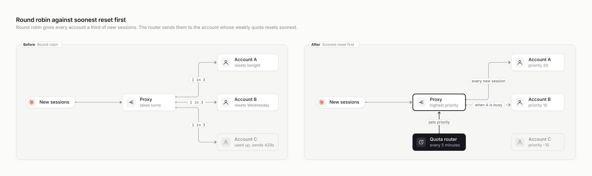
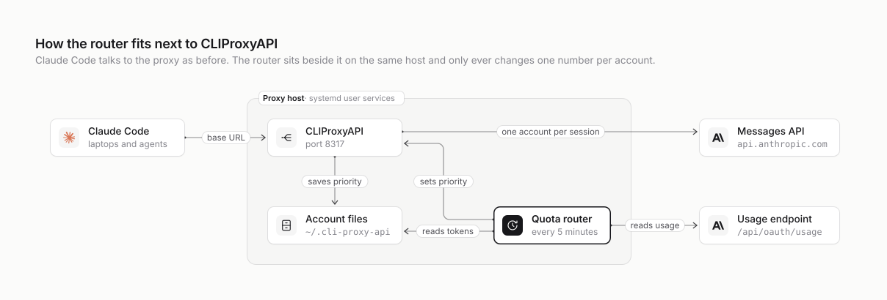

# cpa-quota-router

Get more out of a pool of Claude subscriptions behind
[CLIProxyAPI](https://github.com/router-for-me/CLIProxyAPI). New sessions go to the account whose
weekly quota resets soonest, so quota that is about to expire gets used before it disappears.

<picture>
  <source media="(prefers-color-scheme: dark)" srcset="docs/diagrams/round-robin-vs-soonest-reset.dark.svg">
  
</picture>

## The short version

- **One or two limits per account.** Every Claude subscription has a weekly window. Some still have
  a 5-hour window too, but Anthropic has dropped it on others, and a pool can mix both kinds.
  Whatever is unused when the weekly window resets is lost.
- **Round robin wastes it.** CLIProxyAPI's round robin spreads sessions evenly, so every account
  drains at the same pace. They all run out at about the same time, which shows up as a burst of
  429s. Meanwhile the account that resets tonight still has quota that nobody will get to use.
- **The router ranks the accounts.** It is a small Python service that runs next to the proxy.
  Every 5 minutes it asks Anthropic how much of each account is used and when that account resets.
  It then ranks the accounts and writes the ranking into each account's `priority` through the
  proxy's management API.
- **The proxy does the rest.** CLIProxyAPI already sends every *new* session to the
  highest-priority account and keeps running sessions where they are. New work therefore flows to
  the account that resets soonest, and running sessions keep their prompt cache.
- **Nothing in the proxy changes.** There is no fork or patch, and the proxy doesn't need a
  restart. If the router stops, the proxy keeps the last priorities it was given. Running
  `--reset` puts it back on plain round robin.

## How it fits

<picture>
  <source media="(prefers-color-scheme: dark)" srcset="docs/diagrams/how-it-fits.dark.svg">
  
</picture>

## Read more

| | |
| --- | --- |
| [How it works](docs/how-it-works.md) | The idea, what the proxy already does, what the router adds, how it ranks, and a worked week |
| [How it fits](docs/how-it-fits.md) | Where it runs, what it talks to, and what it can and can't touch |
| [Running it](docs/running-it.md) | Installing, checking, tuning, turning it off, upgrading and troubleshooting |
| [Design decisions](docs/design-decisions.md) | Why it steers with priorities instead of a fork or a plugin, and what could come next |

## Quick start

Check these first:

- **The proxy.** CLIProxyAPI v8 must be running as your user under systemd on Linux, with
  `routing.session-affinity: true` in its config. Without affinity, the router still runs and logs a
  normal ranking, but every request follows the ranking and running sessions lose their prompt
  cache. Nothing warns you about this.
- **The management key, in plaintext.** If `management.secret-key` is empty (the installer's
  default) or only shows a `$2a$…` hash, see [Running it](docs/running-it.md#install).
- **Python 3.9 or newer.** Only the standard library is used.
- **Access to this repository.** It's private, so you need to be added as a collaborator.

Then, on the machine that runs CLIProxyAPI, as the same user. If the proxy runs as a dedicated
user that you manage with `sudo`, follow
[When the proxy runs as its own user](docs/running-it.md#when-the-proxy-runs-as-its-own-user)
instead.

```sh
git clone git@github.com:rokas-tarasevicius/cpa-quota-router.git ~/cliproxyapi/quota-router
# or: gh repo clone rokas-tarasevicius/cpa-quota-router ~/cliproxyapi/quota-router

# Paste the plaintext management key, press Enter, then Ctrl-D. It stays out of your shell history.
(umask 077 && cat > ~/cliproxyapi/quota-router.key)

# Look before you touch anything: prints the ranking and changes nothing.
python3 ~/cliproxyapi/quota-router/quota_router.py \
  --management-key-file ~/cliproxyapi/quota-router.key --once --dry-run

mkdir -p ~/.config/systemd/user
cp ~/cliproxyapi/quota-router/deploy/cpa-quota-router.service ~/.config/systemd/user/
systemctl --user daemon-reload
systemctl --user enable --now cpa-quota-router
loginctl enable-linger "$USER"     # start at boot without a login; may need sudo
journalctl --user -u cpa-quota-router -f
```

[Running it](docs/running-it.md) has the details, the options, how to turn it off again, and the
setups these steps don't cover (a proxy in Docker, no systemd, and so on).

## Tests

```sh
python3 -m unittest                              # the ranking and the run loop, no network
python3 e2e/run_e2e.py /path/to/cli-proxy-api    # a real proxy binary, dummy accounts, a mock Anthropic
```

The end-to-end test stays on localhost. It starts the real CLIProxyAPI binary with dummy accounts
and a mock Anthropic server. It checks that the router writes the right priorities through the
API, that they are saved to disk without touching the tokens, and that the proxy sends new
sessions to the top account while keeping running sessions where they were. With
session affinity turned off, that last check fails, so the test does catch it.

CI runs both on every push, on the self-hosted agentbox runners. The end-to-end test runs against
two pinned CLIProxyAPI releases: the one agentbox runs and the newest (`.github/workflows/test.yml`).

## Layout

```
quota_router.py          the router: one file, standard library only
test_quota_router.py     unit tests
e2e/                     end-to-end test and the mock Anthropic server it uses
deploy/                  systemd user unit
docs/                    the explanation; docs/diagrams/ holds the diagram sources and SVGs
```
