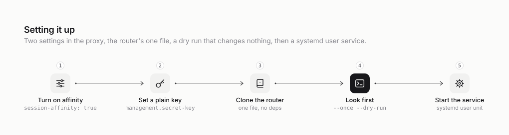

# cpa-quota-router

[](https://github.com/rokas-tarasevicius/cpa-quota-router/actions/workflows/test.yml)
[](LICENSE)


**Spend the Claude quota that expires first.** A small sidecar for
[CLIProxyAPI](https://github.com/router-for-me/CLIProxyAPI) that sends new sessions to the Claude
subscription whose weekly quota resets soonest, so quota that is about to expire gets used before
it disappears.

<picture>
  <source media="(prefers-color-scheme: dark)" srcset="docs/diagrams/round-robin-vs-soonest-reset.dark.svg">
  
</picture>

## Why

- **Unused weekly quota is lost.** Every Claude subscription has a weekly usage window. Whatever
  is left when it resets is gone. Some plans also have a 5-hour window; others no longer do, and a
  pool can mix both kinds.
- **Round robin wastes it.** CLIProxyAPI's round robin spreads sessions evenly, so every account
  drains at the same pace. They all run out at about the same time, which shows up as a burst of
  429s. Meanwhile the account that resets tonight still has quota that nobody will get to use.
- **Soonest reset first doesn't.** Sending new work to the account whose quota expires first
  never uses less quota than round robin, and uses more whenever an account would have reset with
  quota to spare. Accounts also drain one after another, so there is always a fresh one behind the
  account that runs out.

## How it works

The router is one Python file that runs next to the proxy. Every five minutes it:

1. asks the proxy's management API which Claude accounts it has;
2. asks Anthropic how much of each account is used and when it resets (the same call as Claude
   Code's `/usage`);
3. ranks the accounts: soonest weekly reset first, accounts near a 5-hour limit lower, used-up
   accounts last;
4. writes the ranking into each account's `priority` through the management API.

CLIProxyAPI already sends every *new* session to the highest-priority account and keeps running
sessions where they are. So new work flows to the account that resets soonest, and running
sessions keep their prompt cache. There is no fork or patch, the proxy doesn't need a restart, and
if the router stops, the proxy keeps the last priorities it was given.

<picture>
  <source media="(prefers-color-scheme: dark)" srcset="docs/diagrams/how-it-fits.dark.svg">
  
</picture>

## Requirements

- **CLIProxyAPI v8** with Claude accounts logged in, and `routing.session-affinity: true` in its
  config. Without affinity the router still runs and logs a normal ranking, but every request
  follows the ranking and running sessions lose their prompt cache. Nothing warns you about this.
- **The management key, in plaintext.** If `management.secret-key` is empty (the installer's
  default) or only shows a `$2a$…` hash, set a new plaintext value there first. See
  [Running it](docs/running-it.md#install).
- **Python 3.9 or newer.** Only the standard library is used.
- **Linux with systemd** for the bundled service unit. Anywhere else, run the script under whatever
  keeps services up there; see [setups these steps don't cover](docs/running-it.md#setups-these-steps-dont-cover).

## Quick start

<picture>
  <source media="(prefers-color-scheme: dark)" srcset="docs/diagrams/setup.dark.svg">
  
</picture>

On the machine that runs CLIProxyAPI, as the user it runs as. (If the proxy runs as a dedicated user
that you manage with `sudo`, follow
[When the proxy runs as its own user](docs/running-it.md#when-the-proxy-runs-as-its-own-user)
instead.)

```sh
git clone https://github.com/rokas-tarasevicius/cpa-quota-router.git ~/cliproxyapi/quota-router

# Paste the plaintext management key, press Enter, then Ctrl-D. It stays out of your shell history.
(umask 077 && cat > ~/cliproxyapi/quota-router.key)

# Look before you touch anything: prints the ranking and changes nothing.
python3 ~/cliproxyapi/quota-router/quota_router.py \
  --management-key-file ~/cliproxyapi/quota-router.key --once --dry-run

# Run it every five minutes as a systemd user service.
mkdir -p ~/.config/systemd/user
cp ~/cliproxyapi/quota-router/deploy/cpa-quota-router.service ~/.config/systemd/user/
systemctl --user daemon-reload
systemctl --user enable --now cpa-quota-router
loginctl enable-linger "$USER"     # start at boot without a login; may need sudo
journalctl --user -u cpa-quota-router -f
```

The dry run prints one line per account:

```
INFO would set acc***t-a@example.com: priority 20 (ready), weekly 96% resets in 11.2h, 5h 4%
INFO would set acc***t-b@example.com: priority 10 (ready), weekly 19% resets in 112.2h, no 5h limit
INFO would set acc***t-c@example.com: priority -10 (weekly-full), weekly 100% resets in 70.2h, no 5h limit
```

To undo everything, stop the service and run the script with `--reset`. That clears every Claude
priority and puts the proxy back on plain round robin. [Running it](docs/running-it.md) has the
details, every option, upgrading and troubleshooting.

## Options

| Flag | Default | What it does |
| --- | --- | --- |
| `--management-key-file` | | File holding the management key (or set `CPA_MANAGEMENT_KEY`) |
| `--management-url` | `http://127.0.0.1:8317/v0/management` | Where the proxy's management API is |
| `--interval` | `300` | Seconds between runs |
| `--weekly-ceiling` | `99` | Weekly use (%) at which an account counts as used up |
| `--five-hour-ceiling` | `90` | 5-hour use (%) at which an account drops below the ready ones; ignored for accounts without a 5-hour limit |
| `--once`, `--dry-run`, `--reset` | | Run once; log without changing anything; clear every priority |

The full list, with environment variables, is in [Running it](docs/running-it.md#options).

## FAQ

**Does it move running sessions?** No. Moving a session throws away its prompt cache, so only new
sessions follow the ranking. A running session moves only when its account returns a 429, and
then the proxy moves it, not the router.

**What if the top account runs out mid-session?** The proxy cools that account down and retries
on the next one; the router moves the account down at its next run.
[How it works](docs/how-it-works.md#7-when-something-goes-wrong) walks through it.

**My accounts have no 5-hour limit any more. Does it still work?** Yes. An account whose usage
reports `"five_hour": null` is ranked on its weekly reset alone, and a pool can mix accounts with
and without one.

**What if Anthropic changes the usage endpoint?** The endpoint is undocumented. If reads fail,
the router leaves every priority where it was and logs a warning, and the proxy carries on as
before.

**Where do my tokens go?** Each account's access token is read from the proxy's account file and
sent only to `api.anthropic.com`, which the proxy already does with it. Nothing is logged except
masked addresses, priorities and percentages. See [Security](docs/how-it-fits.md#security).

**Codex or Gemini accounts?** Not yet; only Claude accounts are ranked, and the others keep their
priority. ChatGPT reports similar numbers, so Codex could be added the same way.

## Documentation

| | |
| --- | --- |
| [How it works](docs/how-it-works.md) | The idea, what the proxy already does, what the router adds, how it ranks, a worked week, and what happens when something goes wrong |
| [How it fits](docs/how-it-fits.md) | Where it runs, what it talks to, what it can and can't touch, and what it needs from the proxy |
| [Running it](docs/running-it.md) | Installing, checking, tuning, turning it off, upgrading and troubleshooting |
| [Design decisions](docs/design-decisions.md) | Why it steers with priorities instead of a fork or a plugin, and what could come next |
| [Changelog](CHANGELOG.md) | What changed in each version |

## Development

```sh
python3 -m unittest                              # the ranking and the run loop, no network
python3 e2e/run_e2e.py /path/to/cli-proxy-api    # a real proxy binary, dummy accounts, a mock Anthropic
```

The end-to-end test stays on localhost. It starts the real CLIProxyAPI binary with dummy accounts
and a mock Anthropic server, and checks that the router writes the right priorities, that they are
saved without touching the tokens, and that the proxy sends new sessions to the top account while
keeping running sessions where they were. CI runs both on every push and pull request, against two
pinned CLIProxyAPI releases (`.github/workflows/test.yml`).

```
quota_router.py          the router: one file, standard library only
test_quota_router.py     unit tests
e2e/                     end-to-end test and the mock Anthropic server it uses
deploy/                  systemd user unit
docs/                    the explanation; docs/diagrams/ holds the diagram sources and SVGs
```

Contributions are welcome: see [CONTRIBUTING.md](CONTRIBUTING.md). To report a security problem,
see [SECURITY.md](SECURITY.md).

## Disclaimer

This project is not affiliated with or endorsed by Anthropic or the CLIProxyAPI authors. It reads
an undocumented Anthropic endpoint that may change without notice. You are responsible for using
your subscriptions in line with the terms that apply to them.

## License

[MIT](LICENSE)
