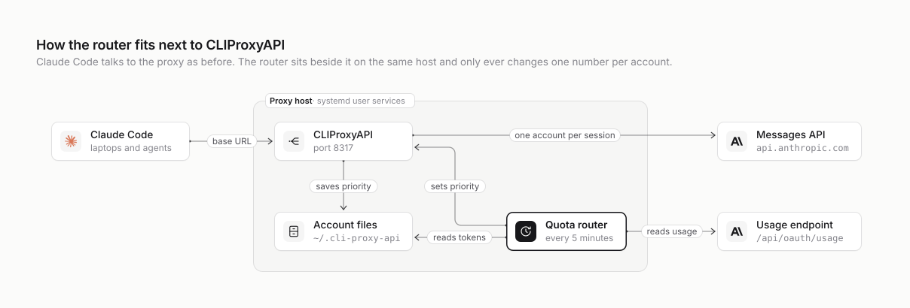

# How it fits

The router is a sidecar. It runs on the same machine as CLIProxyAPI, as the same user, and talks to
three things: the proxy's management API, the proxy's account files and Anthropic's usage
endpoint. Nothing else in the setup changes, and Claude Code doesn't know it exists.

<picture>
  <source media="(prefers-color-scheme: dark)" srcset="diagrams/how-it-fits.dark.svg">
  
</picture>

## The pieces

| Piece | What it is | What it does here |
| --- | --- | --- |
| Claude Code | the CLI on laptops and agent machines | Points `ANTHROPIC_BASE_URL` at the proxy and sends `X-Claude-Code-Session-Id` with every request |
| Tailscale | the private network | Makes the proxy's port reachable from the tailnet and nowhere else |
| CLIProxyAPI | the proxy, a Go binary run as a systemd user service | Holds the Claude logins, binds each session to one account and forwards requests to Anthropic |
| Account files | one JSON file per login, in the proxy's `auth-dir` | Hold each account's tokens and, now, its `priority` |
| Quota router | `quota_router.py`, run as a systemd user service | Every 5 minutes, reads usage and sets `priority` on each Claude account |
| Anthropic | `api.anthropic.com` | Serves the requests, and reports usage at `/api/oauth/usage` |

## What the router talks to

| To | Call | Credential | How often |
| --- | --- | --- | --- |
| Proxy management API | `GET /v0/management/auth-files`, `PATCH /v0/management/auth-files/fields` | the management key, as `Authorization: Bearer` | one list per run, plus one write per changed account |
| Account files | reads `access_token` | file permissions: it runs as the proxy's user | once per account per run |
| Anthropic usage endpoint | `GET https://api.anthropic.com/api/oauth/usage` with `anthropic-beta: oauth-2025-04-20` | that account's access token | once per account per run: 36 calls an hour for three accounts |

By default it reaches the management API on `http://127.0.0.1:8317`, so the proxy doesn't need
`management.allow-remote`.

## What it can and can't change

The router changes exactly one thing: the `priority` field of Claude accounts that come from
account files and aren't disabled. It never:

- writes the account files itself. The proxy writes the new priority, through the same code it uses
  to save refreshed tokens, so the two can't overwrite each other;
- touches tokens, the proxy config, other providers (Codex, Gemini and so on), API keys configured
  in the proxy, or disabled accounts;
- sits in the request path. If it is slow, broken or stopped, requests are unaffected.

## What it needs from the proxy

| Setting | Why |
| --- | --- |
| CLIProxyAPI v8 | The management API calls and the `priority` field it uses. Tested against v8.0.44. |
| `routing.session-affinity: true` | Without it, the proxy sends every request, not just new sessions, to the top account. Every turn would move when the ranking changes, and prompt caches would be lost. |
| `routing.session-affinity-rebind-on: quota` | Recommended: sessions stay put through brief errors and only move when their account is really out. |
| `management.secret-key` | The router needs the plaintext key. The config file may only hold its bcrypt hash, which won't do. |
| `routing.strategy` | Any value works. Round robin still decides between accounts that have equal priority. |

## Security

- **The management key** sits in a file only its owner can read (`install -m 600`). The router reads
  it once at start. You can pass it in `CPA_MANAGEMENT_KEY` instead.
- **Access tokens** are read from the account files and sent only to `api.anthropic.com`, which the
  proxy already does with them. They are never logged.
- **Logs** show masked addresses (`acc***t-a@example.com`), priorities and percentages, and nothing
  else.
- **The router opens no ports.** The systemd unit runs it with `NoNewPrivileges` and a `0077` umask.

## Our setup

This is how it runs on `agentbox`, the machine behind our pool:

| | |
| --- | --- |
| Proxy | CLIProxyAPI v8.0.44, `cliproxyapi.service` (systemd user), config at `~/cliproxyapi/config.yaml`, listening on `127.0.0.1:8317` and published to the tailnet with Tailscale Serve |
| Routing | `strategy: round-robin`, `session-affinity: true`, `session-affinity-ttl: 1h`, `session-affinity-rebind-on: quota` |
| Accounts | three Claude subscription logins in `~/.cli-proxy-api`, plus two Codex logins (not ranked) |
| Router | `~/cliproxyapi/quota-router/quota_router.py`, `cpa-quota-router.service` (systemd user), started on 30 October 2026 |
| Key | `~/cliproxyapi/quota-router.key`, mode 600 |
