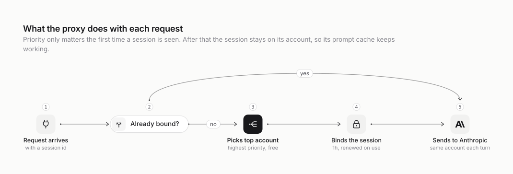
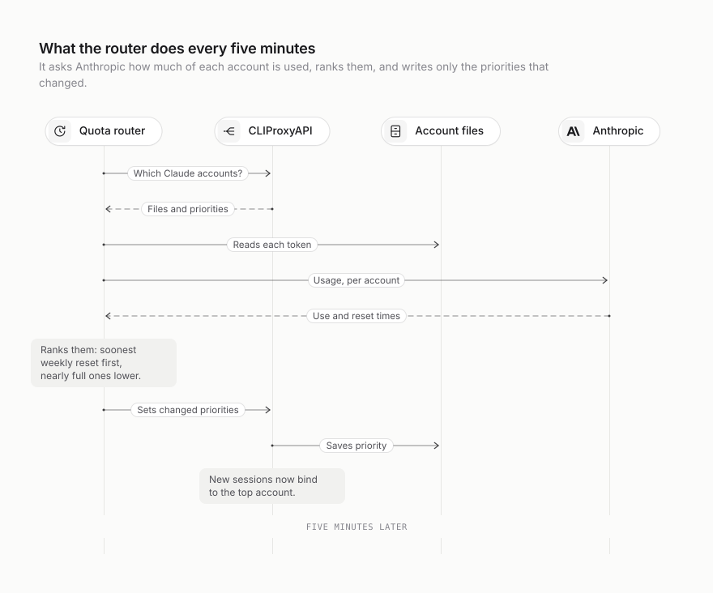
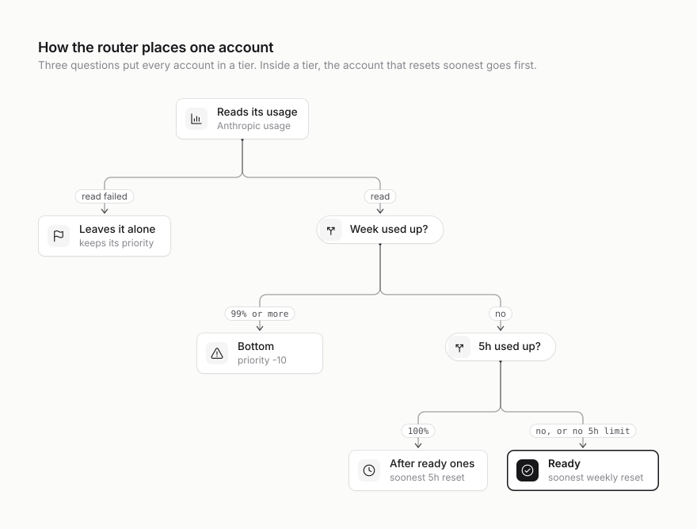
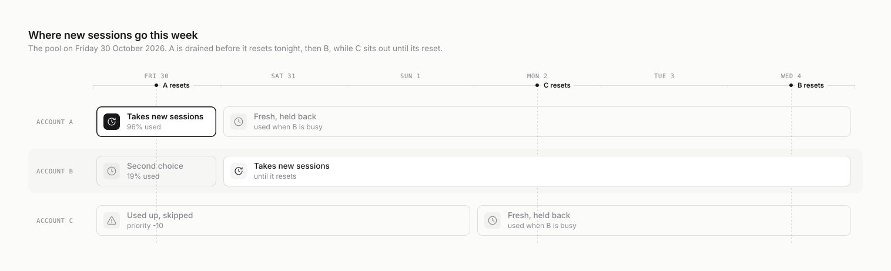
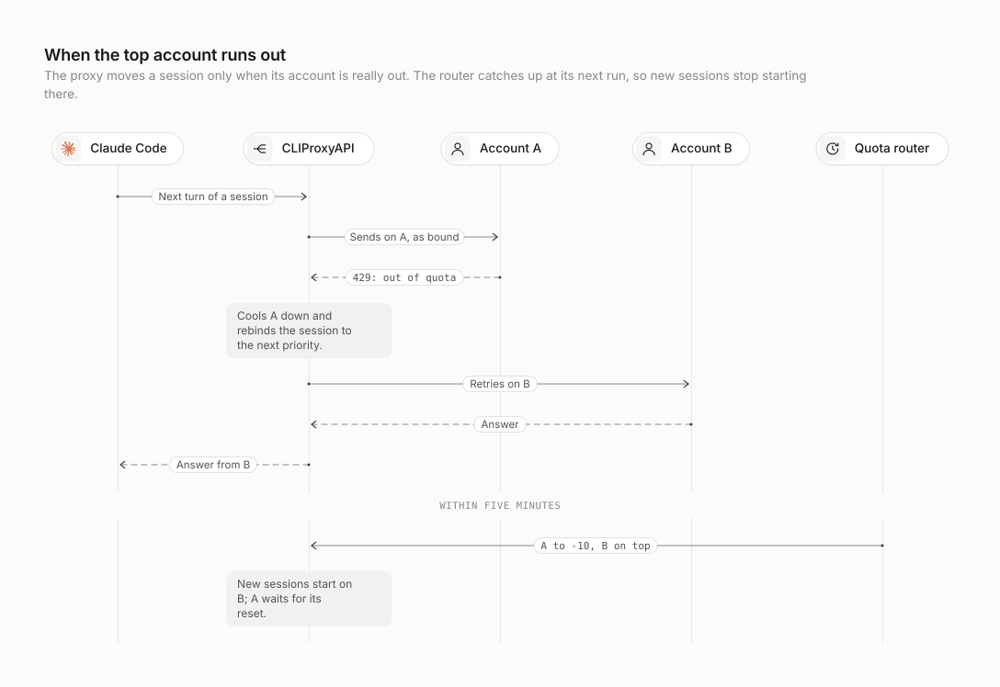

# How it works

This page explains the idea, what CLIProxyAPI already does, what the router adds on top, how it
ranks the accounts, and what happens when something goes wrong.

## 1. The problem

Each Claude subscription in the pool has one or two usage limits:

- a **weekly window**, which caps how much you get in total. It resets seven days after it started.
- on some accounts, a **5-hour window**, which caps how fast you can burn through it. Anthropic has
  dropped it on others: their usage reports `"five_hour": null` (as of 1 November 2026). A pool
  can mix both kinds.

Each account's weekly window started at a different time, so they reset at different times. When
an account's weekly window resets, its usage goes back to zero and **whatever it hadn't used is
gone**.

Here is the pool on Friday 30 October 2026, just before noon UTC:

| Account | Weekly used | Weekly resets | 5 hours used |
| --- | --- | --- | --- |
| A | 96% | tonight, in 11 hours | 4% |
| B | 19% | Wednesday, in 4.7 days | 4% |
| C | 100% | Monday, in 2.9 days | 0% |

CLIProxyAPI was set to round robin, so it gave each account an equal share of new sessions. That
causes two problems:

1. **Quota expires unused.** A has 4% left and resets tonight, yet it only gets a third of new
   work. B, which won't reset for days, gets just as much. Whatever A has left at midnight is lost,
   while B's quota is spent on work that A could have done.
2. **Everything runs out at once.** Because every account drains at the same pace, they all hit
   their limits at about the same time. Each one starts returning 429s, the proxy puts it in a
   cooldown, and requests fail because every account is cooling down at once. That happened on 28 and 29
   October.

## 2. The idea: use what expires first

Treat each account's remaining weekly quota like food with a use-by date: you eat whatever expires
first.

- Quota on the account that resets soonest is the only quota that is about to disappear. Every
  request that runs on A instead of B keeps a request's worth of B for later in the week.
- Quota on accounts that reset later isn't going anywhere today, so it can wait.
- An account whose weekly window hasn't started (it hasn't been used since its last reset) has no
  clock running. Using it starts a fresh seven days, so it goes last.

This rule never uses less quota than round robin does, and whenever an account would have reset
with quota to spare, it uses more. Schedulers call it *earliest deadline first*.

It fixes the second problem as well. Accounts drain one after another rather than all together, so
when the top account runs out there is still a fresh account behind it.

## 3. What CLIProxyAPI already does

The router doesn't route requests itself. It relies on two things the proxy already does once
`routing.session-affinity` is on:

<picture>
  <source media="(prefers-color-scheme: dark)" srcset="diagrams/request-routing.dark.svg">
  
</picture>

- **Sessions stick to an account.** Claude Code sends an `X-Claude-Code-Session-Id` header with
  every request. The first time the proxy sees a session, it binds that session to an account.
  Every later request in the session goes to the same account, whatever its priority, so Anthropic's
  prompt cache for that conversation keeps working. A binding lasts for `session-affinity-ttl` (an
  hour by default) and the clock restarts on every request, so a session that's in use keeps its
  account. Subagents use their parent's account.
- **New sessions go to the highest priority.** To bind a new session, the proxy picks the account
  with the highest `priority` among those that aren't cooling down after a 429. Accounts with equal
  priority share new sessions round robin, which is why everything was evenly spread before: every
  account had the default priority of 0.

With `session-affinity-rebind-on: quota`, a session only moves off its account when that account
can't serve it any more: it is out of quota, its login has failed, it doesn't support the model, or
it is permanently unavailable. Brief errors don't move a session. The default, `any`, also moves a
session on brief errors such as timeouts and 5xx responses, to whichever account the proxy fails
over to.

So `priority` is a lever that changes **where new sessions start** and nothing else. The router
only has to set it well.

## 4. What the router adds

The router is one Python file running as a systemd service next to the proxy. Every five minutes
it does this:

<picture>
  <source media="(prefers-color-scheme: dark)" srcset="diagrams/router-tick.dark.svg">
  
</picture>

1. It asks the proxy's management API which Claude accounts it has, using
   `GET /v0/management/auth-files`. It keeps the ones that come from account files and aren't
   disabled.
2. For each account, it reads the access token from the account file and calls Anthropic's usage
   endpoint (`GET /api/oauth/usage`). This is the call behind Claude Code's `/usage`. It returns
   how much of each window is used (0 to 100%) and when each window resets.
3. It ranks the accounts (section 5).
4. For every account whose priority should change, it sends
   `PATCH /v0/management/auth-files/fields` with the new priority. The proxy applies it straight
   away and saves it in the account file, using the same path it uses for its own token refreshes,
   so the two never overwrite each other. If nothing changed, nothing is written.

It logs one line per account:

```
INFO set acc***t-a@example.com: priority 20 (ready), weekly 96% resets in 11.2h, 5h 4%
INFO set acc***t-b@example.com: priority 10 (ready), weekly 19% resets in 112.2h, 5h 4%
INFO set acc***t-c@example.com: priority -10 (weekly-full), weekly 100% resets in 70.2h, 5h 0%
```

`set` means the priority changed and `keep` means it was already right. A dry run says
`would set`. Email addresses are masked in the log. An account without a 5-hour limit ends its line
with `no 5h limit` instead of a 5-hour percentage.

## 5. How it ranks

<picture>
  <source media="(prefers-color-scheme: dark)" srcset="diagrams/ranking.dark.svg">
  
</picture>

Each account goes into one of three tiers:

| Tier | When | Order inside the tier | Priority |
| --- | --- | --- | --- |
| **ready** | under 99% of the week and, if it has one, some of the 5-hour window left | soonest weekly reset first; unstarted windows last | highest numbers |
| **5h-full** | the 5-hour window used up; only accounts that have one | soonest 5-hour reset first | below every ready account |
| **weekly-full** | 99% or more of the week used | doesn't matter | -10 |

Then the usable accounts (ready, then 5h-full) are numbered from the top in steps of 10. With four
usable accounts that's 40, 30, 20 and 10. Accounts with no weekly quota left get -10, which puts
them below the default of 0.

A few details:

- **Ties.** Ready accounts with the same reset time are ordered by how little of the 5-hour window
  they have used (none, for an account without one), then by name, so the order is stable from one
  run to the next.
- **Accounts without a 5-hour limit.** They are ranked on the weekly reset alone, in the same order
  as everyone else, and never drop to 5h-full. Nothing pulls new sessions off them before the week
  runs out, so the soonest-resetting one takes every new session until it is used up.
- **Passed resets.** A window whose reset time has already passed counts as empty, even if
  Anthropic hasn't caught up yet.
- **Why the weekly reset beats the 5-hour window.** Quota left when the week resets is lost, but
  a 5-hour window comes back within hours. So an account part-way through its 5-hour window keeps
  its place, and the one whose week resets soonest gets the whole window. Only once the window is
  used up do new sessions go elsewhere. Its running sessions carry on until it returns a 429, and
  then the proxy moves them. Once its 5-hour window resets, it goes back to the top at the next
  run. `--five-hour-ceiling` moves new sessions off earlier, if you would rather trade the end of
  the window for fewer sessions moving mid-way; see [Tuning](running-it.md#tuning).
- **Used-up accounts stay enabled.** A used-up account isn't disabled, just put last. If every
  other account is unavailable, the proxy can still try it, exactly as it would have without the
  router.
- **Accounts the router doesn't rank.** If an account's usage can't be read, the router leaves its
  priority alone. Other Claude credentials, such as API keys in the proxy config, keep whatever
  priority they have. At the default of 0 they sit below every ranked account and above the used-up
  ones.

On 30 October that gives A 20, B 10 and C -10: A takes every new session until it resets tonight
or runs out.

## 6. A week, played forward

<picture>
  <source media="(prefers-color-scheme: dark)" srcset="diagrams/week-ahead.dark.svg">
  
</picture>

- **Friday:** A spends its last 4% before midnight, when it resets. If it runs out or uses up its
  5-hour window first, the router moves it down and B takes over early.
- **Saturday to Wednesday:** A's new week hasn't started, so it has no reset time and drops behind
  B. B, whose clock is running, takes new sessions until it resets on Wednesday. A only gets new
  sessions while B is cooling down or out of 5-hour quota.
- **Monday:** C resets. Like A, it is fresh with no clock running, so it waits behind B as a spare.
- **Wednesday:** B resets. The router then ranks whichever accounts have a clock running at that
  point.

That assumes usage carries on roughly as it is. The router re-ranks every five minutes, so if the
picture changes, so does the ranking.

## 7. When something goes wrong

The case that matters most is the top account running out in the middle of a session, which it
will, since it takes every new session until then:

<picture>
  <source media="(prefers-color-scheme: dark)" srcset="diagrams/running-out.dark.svg">
  
</picture>

| What happens | What the router and proxy do |
| --- | --- |
| The router stops or crashes | The last priorities stay in place and the proxy carries on. systemd restarts the router after 30 seconds. |
| One account's usage can't be read | That account keeps its priority, the others are ranked, and a warning is logged. |
| Anthropic changes or removes the usage endpoint | Every read fails, so nothing moves. The proxy behaves as it would with fixed priorities until the router is fixed. |
| The top account hits a limit mid-session | The proxy gets a 429, puts that account in a cooldown and moves the session to the highest-priority free account. The router moves the account down at its next run. |
| The proxy restarts | Priorities are saved in the account files, so they survive. Session bindings live in memory, so they don't: each running session binds again on its next request, to the current top account, and loses its prompt cache once. |
| A new account is added | It starts at priority 0, below every ranked account, and is ranked at the next run (within 5 minutes). |
| An account is disabled | The router skips it. |
| Lots of new sessions start at once | They all go to the top account until it returns 429s or the router moves it down. That's deliberate: it spends the soonest-expiring quota first. |

## 8. What it doesn't do

- **Codex.** Only Claude accounts are ranked. ChatGPT exposes similar numbers at
  `/backend-api/wham/usage`, so Codex accounts could be added the same way.
- **Running sessions never move.** That's on purpose, to keep prompt caches. A long session on an
  account that is no longer top stays there until that account returns a 429.
- **It doesn't throttle or queue anything.** It only decides where new sessions start.
